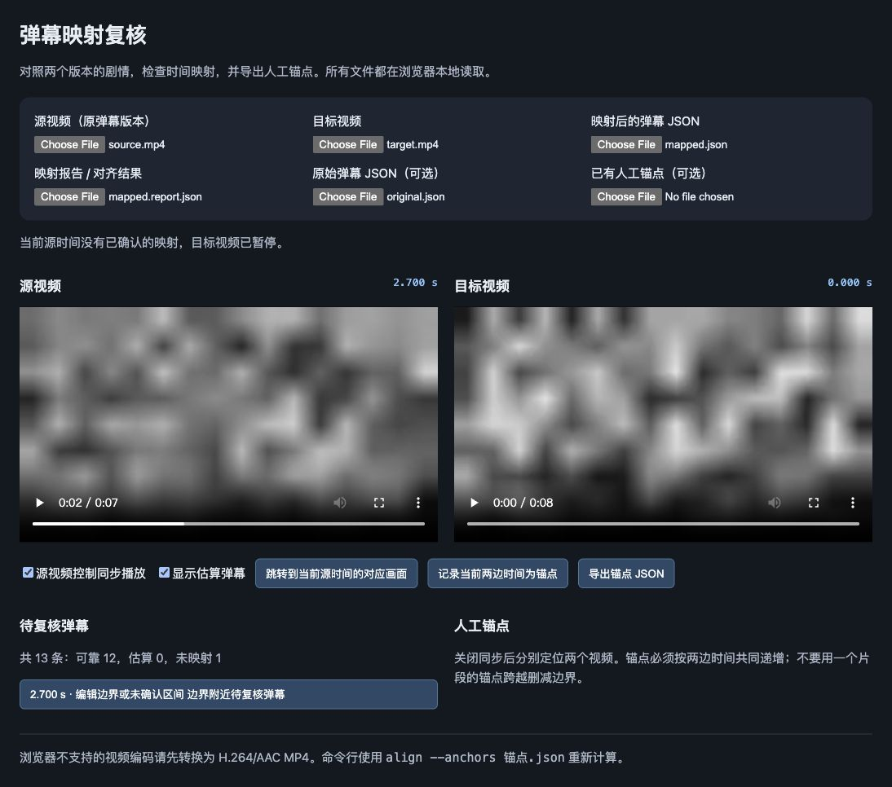

# 2026-10-14 开发验收记录

本次实现覆盖新版 CPU 映射算法、严格/宽松模式、CLI、批量配对、人工锚点、缓存、旧入口包装、下载器流程修复及本地双视频播放器。代码未提交或推送。

## 视觉版 0.2.0 的已验证记录

- Python：50 项测试通过（Python 3.11.13，FFmpeg 8.1.1，macOS ARM64）。
- JavaScript：`node tests/test_player.mjs` 通过；`node --check player.js` 通过。
- 打包：editable 包和 wheel 构建成功，wheel 中确认包含映射核心、CLI 与全部离线播放器资源；模块命令和 `bili-danmaku-mapper` 安装入口可用；`pip check` 无依赖冲突；`doctor` 的依赖、FFmpeg/FFprobe 和软件解码检查通过。
- 时间基准：VFR 抽帧时间与 ffprobe 源帧 PTS 一致；非零起始时间的 MKV 也验证了实际可见时长与局部解码时间。
- 准确性：重复画面不允许时间倒退；完整重复片段默认不猜测，人工锚点能指定第二份片段；长静止区间在严格模式下进入复核，在宽松模式下标为估算。
- 文件流程：覆盖缓存损坏恢复、并行缓存、独占输出、拒绝覆盖、序列化失败保留旧结果、不连续集数、显式配对、带空格及引号路径、失败下载不发布残片、下载迭代器 EOF，以及凭据刷新保存。下载器测试使用假客户端和假凭据，没有访问账号。
- 播放器：实际浏览器加载两份合成视频、映射弹幕、报告和原始弹幕；点击未映射弹幕定位到源 2.700 秒，目标保持暂停；记录 0→0 人工锚点并导出 JSON，文件内容已读取验证。原生视频 Home 定位和同步复选框也已验证。纯函数测试另验证跳转、锚点校验和失配暂停。

## 合成视频指标

所有素材都是确定性移动灰度纹理，约 6–8 秒；源为 24 fps，目标为 30 fps，另有 VFR、变速、字幕条/黑边和重新编码变体。每 0.1 秒生成待映射弹幕，包含头尾与边界时间；表中的分母是全部弹幕，不删除拒绝结果。采样使用默认 2 fps，默认严格模式。

| 场景 | 可靠输出 / 全部 | 新版误差 P95（ms） | 冷启动耗时 新 / 旧（s） | 缓存 新 / 旧（KiB） |
|---|---:|---:|---:|---:|
| identity | 73/76 | 0.0 | 0.537 / 0.465 | 24.6 / 293.5 |
| head_cut | 60/69 | 0.0 | 0.461 / 0.464 | 23.4 / 282.0 |
| middle_cut | 58/66 | 0.0 | 0.466 / 0.515 | 23.2 / 277.3 |
| speed | 58/60 | 8.3 | 0.442 / 0.461 | 22.3 / 268.1 |
| overlay | 73/76 | 20.0 | 0.467 / 0.464 | 24.6 / 293.4 |
| target_cut | 58/76 | 0.0 | 0.448 / 0.463 | 23.2 / 273.3 |
| vfr | 73/76 | 20.0 | 0.453 / 0.456 | 24.6 / 261.7 |
| reencode | 73/76 | 20.0 | 0.453 / 0.472 | 24.7 / 295.1 |

新版所有已接受弹幕均在已知正确位置 200 ms 内（当前合成集合的匹配精度 100%），未发生删除区间吸附。目标删去的区间计入未映射，可靠输出比例较低是预期行为。全部样例的可靠输出比例约 76%–97%，详细统计、峰值 RSS 和最大误差保存在 [acceptance-metrics.json](acceptance-metrics.json)。峰值 RSS 来自各自独立 Python 进程，约 62–64 MiB。

旧基线保留原 AAP 全帧哈希匹配，但为比较使用真实 PTS 和安全的非递增过滤，原始锚点同时保留在诊断中。它并非原来“所有弹幕无限吸附”的原样输出。头部删减、中间删减和变速样例中，旧基线接受结果的 200 ms 内精度分别约 86%、93%、97%；新版均为 100%。

短片的解码和进程启动占比较高，新旧耗时大致相当，没有验证速度倍数收益。新缓存约为旧基线的十二分之一。此结果不能推导长片处理时间或长片峰值内存。

## 音频辅助 0.3.0 更新

现已加入默认混合音频辅助、音轨选择、局部指纹与短时频谱复核，以及音画冲突处理。完整回归现为 67 项测试通过。此前八组纯视觉指标保留为历史基线；新增声音场景、验证范围和使用方法见 [audio-alignment.md](audio-alignment.md)，实测指标见 [audio-acceptance-metrics.json](audio-acceptance-metrics.json)。

## 尚未验收

本节为初始算法版本的历史边界。后续真实下载验证见 [工作台验收](workbench-acceptance.md)，长片性能与覆盖率实验见 [性能验收](optimization-acceptance.md) 和 [覆盖率验收](coverage-acceptance.md)；真实对应关系的人工准确率验收仍未完成。

- 真实番剧：旧配置的数据目录不存在，暂无源、目标视频和真实弹幕；真实素材上人工标注后的误差、覆盖率与误匹配率仍待验证。
- 长视频性能：目前只有短合成片测量，不能宣称整集或整季性能达标。
- B 站登录与真实下载：未使用真实账号，也未验证当前登录接口、版权/地域权限和下载流。
- 平台：本次运行只在 macOS ARM64 完成，Linux/Windows 的运行及浏览器表现尚未实机验证。
- 播放器长时间播放与大弹幕集合：基础载入、定位、锚点导出及逻辑验证已完成；长窗口、密集弹幕和更多编码兼容性尚未验收。

## 复现

```bash
python -m pytest -q
node tests/test_player.mjs
python -m bili_danmaku_mapper doctor
python -m tests.benchmark --output docs/acceptance-metrics.json
```

真实素材验收时应使用新输出目录，并记录源/目标内容摘要、人工标注、编辑边界、可靠/估算/未映射比例、时间误差、耗时和缓存大小。成功生成 JSON 或仅播放起来不能替代对齐准确性验收。用户已确认当前没有可用真实素材。

## 播放器复核截图


