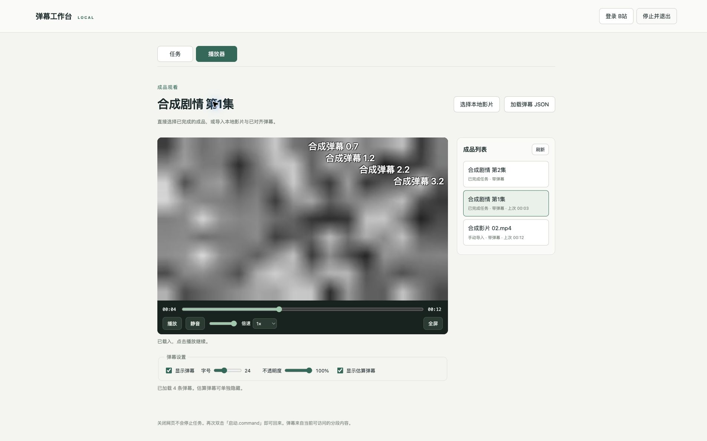

# 成品播放器验收记录（0.5.0）

日期：2026-10-14。此记录覆盖独立观看标签页；下载与对齐的既有验收仍见 [工作台基线验收](workbench-acceptance.md)。

## 自动测试

- `python -m pytest -q`：**117 项通过**，原有 97 项完整保留，新增 20 项成品列表、导入、观看状态、文件权限及失败场景测试。
- `node tests/test_player.mjs`：原双视频复核的映射跳转、锚点校验、失败暂停继续通过。
- `node tests/test_danmaku_renderer.mjs`：共享弹幕渲染验证暂停、倍速、前后跳转、字体、不透明度、估算筛选、内容清空及密集节点上限。
- `node tests/test_watch.mjs`：观看恢复、换集后返回位置、任务完成刷新不打断影片、异步载入竞争、失败载入保留旧内容、恢复失败不阻断任务初始化、解码错误提示，以及全屏请求对象为包含弹幕的观看容器。
- `python -m tests.verify_service_exit`：真实 SSE 连接收到 shutdown 后结束，服务进程正常退出。
- JavaScript 语法检查、Python 编译检查、`pip check` 与 0.5.0 wheel 构建通过。wheel 中的观看组件、共享渲染器与 API 文件已逐字节核对当前源码。

新增服务测试覆盖：不登录、不创建任务导入影片；后加载弹幕；空 JSON；错误 JSON、时间、显示类型与状态参数；文件 ID 与会话限制；重开 SQLite 后保留状态；文件移走后显示不可访问；任务修订版本分开保存进度；成品使用任务最终播放文件；HTTP Range 继续工作。数据库只增加两张表，不重写原任务。

## 本机浏览器操作

使用隔离的 `python -m tests.workbench_preview`，本次生成 12 秒、24/30 fps 两集合成素材，系统选择器用可控替身返回测试文件，下载是替身，对齐仍由真正工作进程执行。

| 场景 | 实际结果 |
|---|---|
| 独立手动观看 | 未建立任何任务时，进入播放器并导入本地影片，能读取 12 秒影片元数据并播放 |
| 后加载弹幕 | 同一影片载入 6 条手动弹幕，保留影片和观看位置 |
| 暂停与恢复 | 以 1.5 倍速播放，切回任务页时在 1.625491 秒暂停；再回播放器保持同一位置和速度，未自动播放 |
| 刷新 | 刷新后回到播放器标签，恢复 1.625491 秒、1.5 倍速、字号 48 和估算筛选关闭状态；倍速控件同步显示实际速度 |
| 错误 JSON | 第二次选择返回损坏 JSON，显示明确错误，原 6 条弹幕与影片保留 |
| 同时处理 | 观看手动成品期间创建两集任务；两集完成后加入成品列表，原影片仍是手动影片，未切换到新任务成品 |
| 任务成品观看 | 从成品列表选择第一集，自动载入最终目标视频及 4 条映射弹幕与估算标记 |
| 换集返回 | 第一集定位至 4.8 秒，切到第二集再返回，仍停在 4.8 秒并保持暂停 |
| 空弹幕 | 为当前成品选择空弹幕 JSON，创建手动观看条目，旧弹幕层清空，影片继续可看，原任务结果保留 |
| 原映射复核 | 单独打开任务的「映射复核」，双视频、报告和锚点工具正常载入，共享渲染器资源无缺失 |

此次浏览器操作主要在后台测试标签进行。浏览器拒绝了后台标签的全屏请求，错误提示已验证；**实际前台进入全屏及其视觉表现仍需人工确认**。自动测试确认全屏请求指向观看容器，浏览器 DOM 检查确认容器内包含影片和弹幕层；不能把这个结构检查当成真实全屏验收通过。

实际 macOS 文件/JSON 对话框完整选取、不同浏览器对具体 MKV/HEVC 编码的解码表现、真实长影片播放，以及原有真实双版本素材准确性验收仍未完成。不支持编码的提示经过事件测试，未用它冒充真实不支持编码文件的浏览器验收。本轮没有重新登录或下载真实 B站素材。

