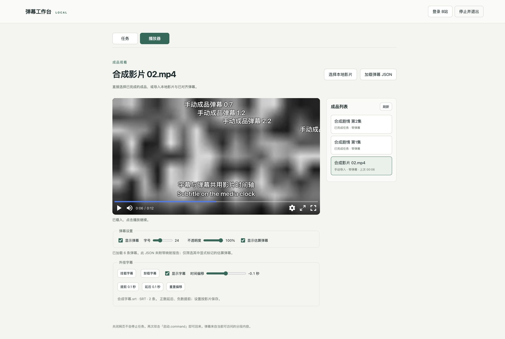

# 成品播放器（0.11.2）

工作台顶部有「观看」和「准备影片」两个网页内标签页。观看成品不需要先登录 B站或创建任务。双视频对照、待复核区间和人工锚点收进高级功能，进入前显示剧透提示。当前默认播放路径见 [按需播放](viewing-upgrade.md)，原音质与原始 ASS 样式请用 [IINA](native-player.md)。下方兼容处理章节也记录旧播放准备接口，普通观影不生成整片副本。

## 两种观看方式

- 项目生成的成品：任务完成后自动出现在播放器的成品列表，点击任务卡片的「观看成品」或列表中的影片即可载入。直接使用原片与对应映射弹幕，播放修复独立进行；新结果版本独立列出，不替换正在观看的旧版本。
- 自己准备的成品：在播放器点击「选择本地影片」，可以直接观看；再点击「加载弹幕 JSON」，选择已对齐的 nplayer 弹幕文件。影片和弹幕都通过 macOS 系统对话框授权，本地影片不复制、不上传。加载错误的 JSON 会保留已载入内容；空弹幕文件合法，仍可观看影片。

「加载弹幕 JSON」只读取现成的时间轴，不会执行弹幕对齐。给任务成品另选弹幕会建立手动导入条目，原任务和原结果不修改。给手动导入的影片更换弹幕则保留同一条目与观看位置。

## 播放控制

观看页现在采用开源 [NPlayer](https://github.com/oyuyue/nplayer) 1.0.15 提供播放/暂停、时间轴、音量、静音、0.25–4 倍速、键盘快捷键、网页全屏及系统全屏。固定版本的脚本、MIT 许可证与来源校验信息随项目提供，不访问 CDN。原先的观看控制层是项目自行编写的；改用 NPlayer 后，工作台状态管理、估算弹幕筛选和复核入口继续保留。

NPlayer 是浏览器播放界面，实际编解码仍由浏览器负责；它并不能保证播放所有 MKV/HEVC 文件。共享弹幕渲染器和外挂字幕层直接挂在 NPlayer 的全屏容器里，复核页继续使用共享弹幕模块。系统画中画通常只包含视频画面，不支持这两个网页叠加层，因此本工作台不提供画中画入口。

全屏请求作用于同时包含影片、弹幕和控制栏的容器。弹幕可开关、调整字号与不透明度；有映射报告或显式 estimated 标记时，可以隐藏估算弹幕。单独导入的普通 nplayer JSON 通常没有可靠性标记，界面会提示这一点，不会声称它们全部可靠。

弹幕运动与生命周期使用视频时间，暂停、倍速和跳转后仍对应当前影片。跳转会清理旧画面中的弹幕，并按新位置恢复仍在显示时间内的弹幕；单个时间点过于密集时最多保留 100 个弹幕节点，防止界面被大量节点阻塞。

切回「任务」标签页会暂停影片，保留位置和设置；回到播放器后手动继续。任务后台继续处理，任务进度更新不会重建视频元素。新成品到达只更新成品列表，不切页、不自动播放、不重置正在观看的影片。选集由用户手动操作，没有自动连播。

每部影片的观看位置、音量、静音、倍速和弹幕设置分别保存到 SQLite。正常播放约每 5 秒保存一次，暂停、定位、调整设置、换集和退出时也保存；刷新后恢复当前条目并默认暂停。强制杀死浏览器或系统断电可能丢失尚未保存的几秒进度。刷新会保留当前网页标签选择；再次双击启动默认打开任务页，播放器仍可恢复最近观看的成品。

## 播放兼容处理

编码支持取决于浏览器。播放器首先尝试原片，包括 MKV，不按扩展名强制创建副本。浏览器报告不支持格式或解码失败（MediaError 3/4）后，自动依次尝试：

1. **无损换封装**：将第一条视频和所选音轨封装为 MP4，视频、音频均 stream-copy，不重新编码。
2. **仅转音频**：如果换封装失败或该文件仍无法播放，保留原视频编码，仅将所选音轨转为 AAC。
3. **完整转码**：前两种方式未能解决问题时，显示「完整转码…」。点击后还需确认，才将视频编码为 H.264、音频编码为 AAC。取消不会启动完整转码。

网络/文件读取错误只提示检查并重试，不触发自动转换。有画面但无声时，浏览器未必报告错误；可以点击「无声或无法播放？修复播放」，先换封装，仍无声再点一次以仅转音频。播放音轨在这里单独选择，切换音轨从原片抽取并优先使用无损封装，不触发重新对齐。原片、弹幕 JSON 和外挂字幕均保留。

每次进入影片先尝试原片，失败时复用已经验证的相同原片/音轨/阶段文件。前两级失败而已存在先前确认生成的有效完整转码文件时，直接复用，不再重复转码或要求确认。「重试原片」可恢复原文件和默认播放音轨。为同一原片准备播放文件不会新建对齐任务、修改人工锚点或替换任务输出。旧版本已完成的结果维持原时间基准，不会在升级时静默改写；新任务及重新对齐始终使用最初选择的原片。

播放准备采用独立进程，最多一个阶段运行，网页仍可操作，其他集数照常下载和对齐。完成文件原子发布；失败文件不视为有效缓存。关闭网页后准备继续；服务停止会结束其拥有的进程组，重启后再次请求会重新执行中断阶段。UI 显示真实阶段与耗时，不提供虚假百分比。

为复用原片的映射与字幕，生成后比较整段视频的展示时间戳：复制视频优先扫描包时间戳，必要时核对解码帧；完整转码核对解码帧。接受每帧最多 2ms 的量化误差及已测得的固定起点差，并在播放器的弹幕、字幕与观看位置中补偿固定偏移。时间比例变化、丢帧、无法验证的时间戳或过大的音轨起点变化会拒绝使用结果。仅设置 `-copyts` 不能替代核对；FFmpeg 官方也说明输出同步与封装器可能改变时间戳。[FFmpeg 文档](https://ffmpeg.org/ffmpeg.html#Advanced-options)

换封装会占用额外磁盘空间；仅转音频会重新编码音频。完整转码耗时更长，可能降低画质、改变 HDR/色彩表现，本轮不承诺 HDR 保真转换。所有策略都可能遇到具体文件不兼容，失败时保留原片与对齐结果，不强行使用时间轴不可靠的播放文件。

## 外挂字幕

先选择或载入影片，再在下方「外挂字幕」点击「挂载字幕」，通过系统对话框选择一份 **SRT、WebVTT（.vtt）、ASS 或 SSA**。可以随时更换、开关或卸载，不复制视频、不烧录字幕，也不修改原字幕文件。字幕挂载不需要 B站登录、下载或对齐任务。

时间偏移范围为 **-5～+5 秒，步进 0.1 秒**，可拖动滑块，或点击「提前 0.1 秒」「延后 0.1 秒」「重置偏移」。**正数延后，负数提前**：对白出现太早就增加偏移；对白太晚就减少偏移。例如原来 10 秒显示的对白，+1.5 秒后在影片 11.5 秒显示。暂停时调整立即更新；跳转和倍速始终以影片时间为准，反复调整不会累积修改原时间轴。

字幕文件、显示开关和偏移按每部成品独立保存，刷新及服务重启后恢复并默认暂停。换片时清理上部影片的字幕；更换字幕默认重置偏移到 0。字幕文件丢失或损坏时提示重新选择，影片仍可播放；无效的新字幕不替换当前字幕。字幕叠加层支持多行与重叠对白，只作为纯文本显示，不执行字幕中的 HTML、脚本或样式。

支持 UTF-8、带 BOM 的 UTF-16/32 和 GB18030 编码。单文件上限 20 MiB、100000 条对白。ASS/SSA 仅显示对白文本与换行，**不保留复杂特效、样式、字体、定位和绘图**；PGS、VobSub 等图片字幕暂不支持。字幕必须对应正在观看的影片版本；整体偏移不能修复字幕自身缺段、删减或变速造成的逐渐错位。

## 数据与接口

观看条目和进度使用 `state.sqlite3` 中的 `playback_items`、`playback_states`；播放准备另存 `playback_preparations`，与对齐任务表独立。完成任务按 `job:<任务ID>` 标识，手动条目按 `manual:<ID>` 标识；旧任务在升级后直接出现在成品列表，无需重新计算。

- `GET /api/playback/items`：完成任务与手动条目的成品列表、每条观看状态、文件是否仍可访问及最近观看条目。
- `POST /api/playback/items`：使用已授权的 `video_id`、可选 `danmaku_id` 创建手动条目；传入手动 `item_id` 可为同一影片更换弹幕。
- `PATCH /api/playback/items/{id}/state`：部分更新 `position`、`volume`、`muted`、`playback_rate`、`danmaku_enabled`、`font_size`、`opacity`、`show_estimated`，以及 `subtitle_id`、`subtitle_enabled`、`subtitle_offset`，以及 `playback_audio_stream`。观看页还发送递增 `write_revision`，服务忽略较旧的保存请求，防止刷新时旧请求覆盖新设置。
- `POST /api/pick`：支持 `playback_video`、`danmaku`、`subtitle` 单文件选择类型，原任务用的多文件与目录选择保留。
- `GET /api/playback/items/{id}/media`：原片视频与音轨信息。
- `GET /api/playback/items/{id}/prepared`：读取同一原片、同一播放音轨的有效已完成阶段。
- `POST /api/playback/items/{id}/prepare`：请求 `remux`、`audio` 或 `transcode` 阶段，后者必须携带确认；只接受成品 ID 和音轨序号。
- `GET /api/playback/preparations/{id}`：阶段状态和已验证的媒体文件 ID。
- `GET /api/playback/subtitles/{file_id}`：读取已由系统对话框授权的字幕并返回标准化纯文本对白，拒绝其他文件类型与任意路径。

这些接口沿用本次启动的会话保护、Host/Origin 校验及文件 ID 授权。大影片继续通过已有 HTTP Range 接口按需读取。文件被移动或删除时，列表显示不可访问，用户重新选择即可；不会自动搜索其他目录。所有页面、脚本和样式均来自项目本地。

字幕与 NPlayer 的新增验收见 [字幕验收记录](subtitle-player-acceptance.md)。

验证范围见 [成品播放器验收记录](finished-player-acceptance.md)。

原片对齐与播放降级的验证见 [播放兼容验收](playback-compatibility-acceptance.md)。
