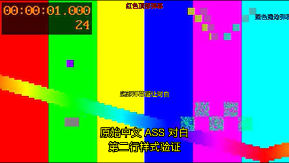

# IINA 原音质、外挂与弹幕验收

版本 0.11.0。开发及媒体验证使用独立源码、数据库和会话，未操作用户已有的 IINA 窗口；没有重新下载或对齐，没有媒体副本。

## 合成素材

通过真实 IINA 1.4.4／mpv 0.38.0 验证：原始 ASS 的黄色字体与双行对白保留；红色顶部、蓝色滚动及底部弹幕同时显示，底部弹幕避开对白。关闭弹幕后原始字幕仍开启；两种偏移独立，静音播放、1.5 倍速、暂停及回拖正常。网页刷新可重连，返回网页恢复位置且暂停。真实全屏窗口切换没有在用户观看期间执行；OSD 使用动态窗口尺寸，相关尺寸与媒体时钟由脚本测试覆盖。

协议测试覆盖：必须选择已授权外挂、保留原文件、脚本失败不能就绪、字幕被关闭的状态、进度所有权、会话重连、认证及参数拒绝。原片读取进程覆盖 Range 字节一致性、Host／路径隔离以及工作台关闭后继续服务。

## 本片

复用原片、原始中文 ASS 和 7,981 条严格接受弹幕，独立测试窗口静音且暂停，没有播放后续剧情或导出电影截图。

- 三路就绪：影片、原始中文外挂、独立弹幕全部确认；外挂 1,071 条对白。
- 源音轨及解码：DTS-HD MA 5.1(side)，48 kHz，解码六声道。
- 当前播放器输出：双声道 PCM，48 kHz；没有应用层 AAC 编码，不能称为真实六声道扬声器输出。
- 原片视频：3840×2160，VideoToolbox／p010，报告保留 BT.2020／PQ 元数据；未进行视频重编码，不将元数据检查等同于 HDR 显示设备验收。
- 采用专属 Range 读取后，几次代表性三路启动约 1.99–2.71 秒；恢复到约 3.49 秒并保持暂停，不是系统冷启动或配对中位性能结论。
- 原片文件身份、大小、mtime、ctime 在最终读取路径下保持不变，ASS 字节不变；没有生成大型副本。

**未完成人工验收：** 外挂的实际对白同步、长期观看、主观音质和物理 5.1 输出。文件名中的 1080p 与原片 2160p 并不能证明失配或同步，未自动改写字幕时间。82.0% 弹幕接受比例仍不等于真实正确率。

机器记录、测试日志和发布前后摘要保存在本地私有实验归档，不随仓库发布。

完整发布回归：229 passed，1 项既有 Starlette/httpx 弃用提示；5 组前端回归通过。真实 IINA 退出控制器后原片读取继续，重连同一会话成功，结束播放器后专属媒体端口释放。

发布方式：检测到原工作台仍在观看，0.11.0 保留在独立目录。启动器只在原工作台正常退出后的下次启动校验、备份并启用；运行中再次双击只打开原工作台，不发布更新。发布前验证候选及现有源码摘要，发生并发修改时停止覆盖。独立发布测试覆盖活跃进程拒绝、原源码变化拒绝、数据库备份、失败回滚及启动顺序。
