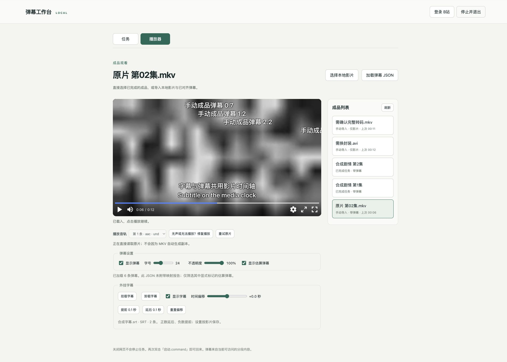
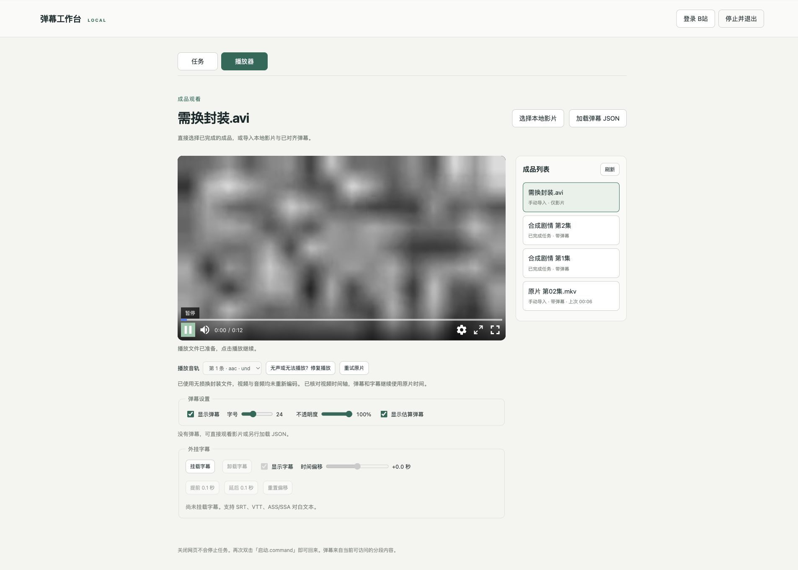

# 原片对齐与播放兼容验收（0.7.0）

日期：2026-10-15。全部素材由 FFmpeg 本地合成，无真实影片、B站账号或用户媒体参与。本轮升级取消了「先转码，再对齐」：对齐与播放兼容处理现在独立运行。

## 实现边界

- 新任务和重新对齐直接读取选择的原片，包括 MKV 和其他音轨；原先 `convert` 字段为旧请求兼容保留，不能再触发对齐前转码。已完成的旧版本结果不会静默重写。
- 正片先尝试原文件。浏览器报告格式/解码错误，或容器中有视频但浏览器只解出音频、没有视频尺寸时，先换封装、再仅转音频。网络/文件读取错误不触发自动转换；有画面但无声可手动点「修复播放」。
- 首两级使用视频 stream-copy。最终完整转码需按钮及明确确认；取消不会运行。已有先前确认并仍有效的完整文件可以复用，不重复转码或再次索取确认。
- 所有播放文件从该成品的原时间基准影片生成，不新建对齐任务，不修改映射 JSON、锚点或外挂字幕。复制视频检查整片包/帧时间戳，完整转码检查解码帧时间戳；每帧误差最多 2ms，固定起点差通过共享媒体时钟补偿。丢帧、变速或无法核实时间轴的结果不会发布。
- 播放准备最多一个独立工作进程运行，使用独立目录及原子发布，SQLite 记录阶段及文件身份。结束服务会终止所属进程组，中断阶段下次请求重新执行；相同原片、音轨和策略的成功结果可复用。

## 自动验证

`python -m pytest -q`：**149 项通过**，在之前 136 项基础上新增 13 项，并将两项旧的「必须先转码」用例更新为原片对齐与独立播放准备行为。

新增验证包括：

- MKV 无需转换选项即可完成真实工作进程对齐；即使旧调用传 `convert=true`，对齐输出仍引用原 MKV，没有生成 playback 文件。
- 无损换封装与仅转音频的输出，解码后视频 SHA-256 与原片相同；音频转换输出为 AAC。
- 三种策略覆盖非零起点与 VFR。非默认音轨能够无损抽取，来源含提前音轨导致的固定起点差被测出并保存；源时间轴变速或截断则拒绝。
- 播放准备独立于任务列表；音轨范围、文件 ID、会话保护、禁止任意路径、完整转码确认，以及结果 HTTP Range 读取通过。
- 同阶段去重、SQLite 重开后复用、失败隔离、真实工作进程组退出及中断阶段恢复通过。

前端四组测试通过：`test_watch.mjs`、`test_danmaku_renderer.mjs`、`test_player.mjs`、`test_subtitle_renderer.mjs`。新增观看测试覆盖降级顺序、取消/确认、网络错误不转换、无画面的音频解码、固定时间偏移补偿、保留弹幕层，以及较晚返回的播放准备结果不能替换新选择的影片。前端单元测试中的 NPlayer/服务为替身；实际浏览器验证见下节。

`python -m tests.verify_service_exit` 通过：真实 SSE 收到 shutdown，服务进程正常退出。`pip check`、脚本语法检查、Python 编译及 0.7.0 wheel 构建通过，已逐字节核对交付包包含最新服务、对齐工作进程、播放准备管理器/工作进程和前端文件。

## 实际浏览器验证

使用 Chrome 与隔离服务 `python -m tests.workbench_preview <独立目录> containers`。影片、弹幕和字幕均为合成数据，系统选择器使用测试替身；参考下载为替身，对齐与播放准备使用真实工作进程和 FFmpeg。

| 场景 | 实际结果 |
|---|---|
| MKV 直放 | H.264/AAC MKV 播放时间前进、画面正常；数据库当时的播放准备数为 0，没有因扩展名生成副本 |
| 原片对齐 | MP4/MKV 两集不勾选转换就开始并完成；检查任务产物，目标分别为原 MP4 和原 MKV |
| 弹幕与字幕 | 原 MKV 直接载入 6 条手动弹幕及双语 SRT，定位到 6 秒显示正常；重启后恢复 |
| 无损降级 | 时间戳完整、无 B 帧的 H.264/AAC AVI 被浏览器拒绝直放，自动换封装后可以播放，UI 显示视频/音频未重编码 |
| 不可靠时间戳 | 一份含缺失帧时间戳的 AVI 没有作为安全的播放文件发布；此类片源不能承诺通过换封装修复 |
| 完整转码前确认 | FFV1/AAC MKV 在浏览器中只能解出音频；检测后两种视频复制策略均失败，才显示完整转码按钮 |
| 取消 | 点击完整转码后取消；SQLite 中完整转码任务数量仍为 0 |
| 确认后执行 | 确认后实际转为 H.264/AAC，载入 256×144 画面，点击播放后时间前进；对齐任务仍为原来的 2 项 |
| 重启复用 | 退出服务、使用同一隔离数据库重启，先尝试 FFV1 原片后复用先前确认过的文件；提示「无需再次转码」，没有再弹确认 |
| 退出 | 本轮所有隔离服务和测试标签均已关闭，无常驻服务 |

本轮浏览器实际覆盖直放、无损换封装和确认后的完整转码；「仅转音频」由真实 FFmpeg 输出、视频哈希和音轨频率测试验证，没有用其替代浏览器可听声音的人工验收。没有真实长片、HDR 保真、多浏览器/不同硬件解码或真实原片字幕验收；不声称所有 MKV/AVI 都能播放。

## 0.7.1 空间保护与旧服务诊断

2026-10-15 对用户提供的大体积原片仅作元数据检查：约 82.81 GiB、137.7 分钟、3840×2160 HEVC Main 10，内含 DTS-HD MA/AC-3 音轨；视频流自身约 78.43 GiB，而目标磁盘可用约 23.35 GiB。整片换封装和仅转音频仍需写入几乎完整的视频流，因此不适合在此剩余空间下执行。此检查未下载参考视频、未对齐真实影片、未生成任何真实影片播放副本。

新增空间保护：开始前保守估算「原文件大小 + max(2 GiB, 原文件大小的 5%)」；空间不足则不排入播放准备队列。CRF 输出大小不可保证，编码期间另检查至少 2 GiB 的剩余空间，必要时停止所属编码进程并删除本阶段未完成的媒体。失败/中断后不保留巨大的无效临时副本；已完成结果及原片不清理。该估算较保守，不等于输出体积承诺，也不提供指定体积的压缩选项。

新增测试覆盖前置拦截、目标分区识别、写入时停止及临时文件清理；退出测试另外确认中断阶段的 partial 文件被清理。`/health` 增加原片对齐和空间保护能力标志，用于区分磁盘源码与实际运行服务。旧服务即使被启动脚本复用也不会自动载入新 Python 源码，需完整重启服务。
