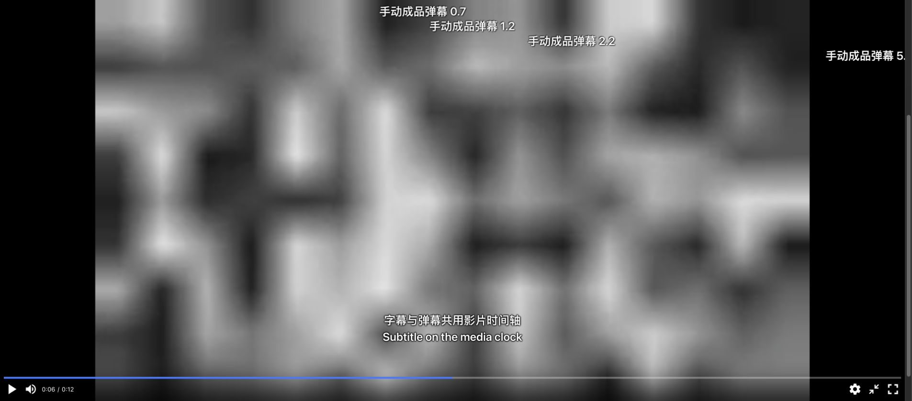

# 字幕与 NPlayer 验收记录（0.6.0）

日期：2026-10-15。本轮只升级正片观看标签页；原有双视频映射复核继续保留。没有真实影片素材，本轮不声称完成真实片源字幕或映射准确性验收。

## 实现与依赖

观看控制使用 [NPlayer](https://github.com/oyuyue/nplayer) 1.0.15，来源为官方 npm tarball，先按 npm SHA-512 integrity 校验，再将原始 bundle 随项目本地分发。MIT 许可证来自对应发布提交，来源和 bundle SHA-256 见 `web/vendor/nplayer-1.0.15/provenance.json`。运行不加载 CDN、不要求 Node。

截至此次核对，npm 最新版本仍为 1.0.15，发布时间为 2022-07-18。选择它是因为现有控件、快捷键和全屏适合观看场景，不能据此声称上游近期活跃发布。项目保留自行维护的工作台状态、媒体时钟弹幕层、估算筛选和字幕组件；没有使用同名 iOS 商业应用。

修复了接入过程中复现的三处问题：隐藏标签首次挂载时设置菜单尺寸为零；恢复速度后菜单仍显示「正常」；快速刷新时较旧的保存请求可能覆盖较新的字幕偏移。适配代码不修改 vendored bundle。另禁用 NPlayer 1.0.15 的 canplay 自动跳至 0.3 秒行为，确保零点和叠加层使用一致的媒体时钟。

## 自动验证

- `python -m pytest -q`：**136 项通过**，保留之前 117 项，新增 19 项字幕解析、文件授权、状态隔离、恢复和保存顺序测试。
- `node tests/test_subtitle_renderer.mjs`：正负偏移、上下限、0.1 秒步进、暂停立即生效、重叠对白、时间边界、跳转、倍速、不累积修改、清空和 100000 条字幕检索通过。
- `node tests/test_watch.mjs`：观看状态、异步切片、任务完成不打断、字幕恢复/清理/更换失败保留旧内容，以及叠加层挂在 NPlayer 全屏根节点内通过。此处 NPlayer 使用替身；真实引擎验证见下表。
- `node tests/test_danmaku_renderer.mjs` 和 `node tests/test_player.mjs`：原有共享弹幕与双视频复核回归通过。
- `python -m tests.verify_service_exit`：真实 SSE 收到 shutdown 后结束，服务进程正常退出。
- `pip check` 无损坏依赖；0.6.0 wheel 构建通过，并逐字节确认包含当前观看脚本、字幕组件、NPlayer bundle、许可证和来源信息。

字幕解析测试覆盖 SRT、VTT、ASS/SSA、UTF-8 BOM、UTF-16/32、GB18030、双语换行、时间排序与重叠、HTML/脚本纯文本处理、ASS 绘图与覆盖标记、损坏时间轴、空文件、体积及条数限制。API 拒绝任意路径、未登记文件、错误文件类型及超出 -5～+5 秒的偏移；字幕丢失不会将影片标记为不可播放。

## 实际浏览器验证

Chrome 使用隔离的 `tests.workbench_preview`，播放 12 秒合成影片。系统选择器使用替身返回本次合成文件，下载使用替身，对齐仍通过真实工作进程。未登录 B站或读取用户影片。

| 场景 | 实际结果 |
|---|---|
| 正片引擎 | 真正的本地 NPlayer bundle 初始化并播放影片，时间轴、音量、快捷键与倍速菜单可用 |
| 外挂字幕 | 单独导入影片、6 条弹幕及两条双语 SRT，画面同时显示字幕与弹幕 |
| 字幕开关与卸载 | 关闭显示立即隐藏；卸载清空叠加层并禁用偏移控件，影片保持载入 |
| 时间偏移 | 暂停在 6 秒，+5 秒显示原 1 秒对白；-5 秒无对应对白，立即隐藏；重置后恢复原 6 秒双语对白 |
| 字幕持久化 | 刷新恢复字幕与 0.2 秒偏移，影片停在 6 秒、1.5 倍速；菜单也显示 1.5× |
| 零点 | ArrowLeft 回退后实际 `currentTime` 为 0，没有自动跳到 0.3 秒 |
| 标签切换 | 1.5 倍速播放时切回任务页，在 6.504054 秒暂停，后台任务继续 |
| 后台任务 | 两集合成任务完成后加入列表，仍观看原手动影片，字幕与 0.2 秒偏移保留 |
| 换片与返回 | 选择第一集任务成品，旧字幕清空；返回手动影片恢复字幕、偏移与倍速 |
| 进程重启 | 从网页停止并退出后，使用同一隔离 SQLite 重开服务；恢复在 6 秒、1.5 倍速、-0.1 秒字幕偏移，默认暂停 |
| 网页全屏 | 真正进入 NPlayer 网页全屏，影片、弹幕、双语字幕和控制栏一起显示，截图已保存 |
| 退出 | 本轮创建的验收服务和测试标签均已关闭，未注册后台服务 |

系统全屏的原生权限及前台视觉效果仍需人工确认，不能用网页全屏冒充系统全屏验收。真实 macOS 字幕对话框完整选取、各浏览器不同编码表现、真实长片字幕同步仍未完成。ASS/SSA 已做解析测试，本轮浏览器使用 SRT；复杂 ASS 特效和图片字幕不在实现范围。

