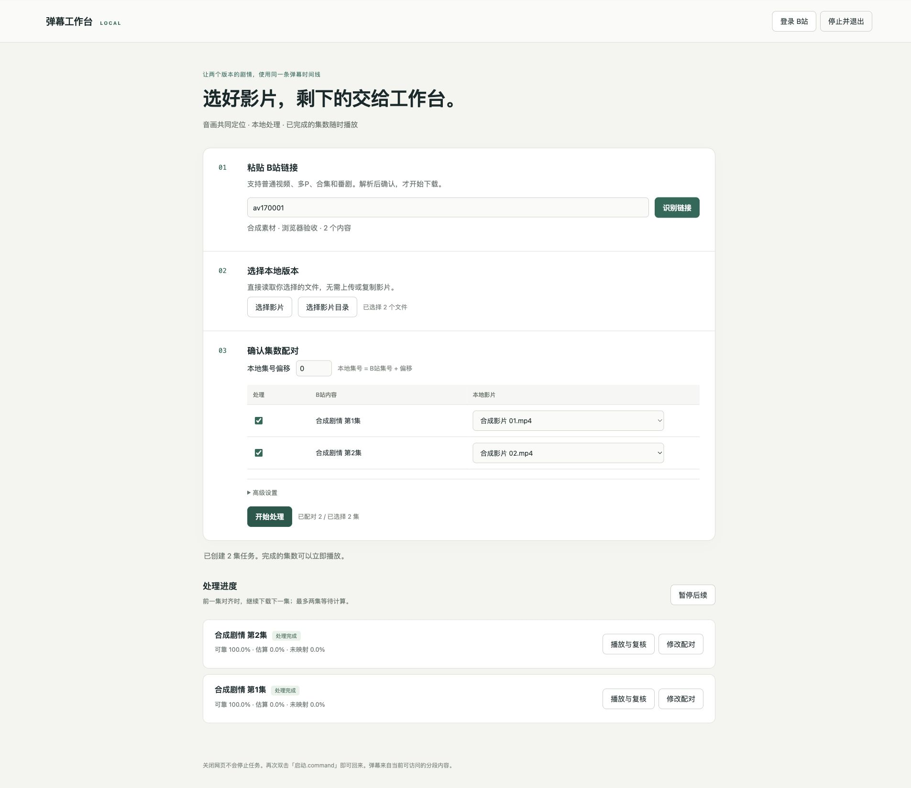

# 工作台分项验收记录（0.4.0 基线）

新增成品观看功能见 [0.5.0 成品播放器验收](finished-player-acceptance.md)。

日期：2026-10-14。环境：macOS，Python 3.11.13，FFmpeg/FFprobe 8.1.1；FastAPI 0.143.1、Uvicorn 0.54.0、Starlette 1.8.0。没有真实未审查影片，也没有代用户完成扫码或验证码。

## 自动验证

`python -m pytest -q`：**97 项通过**，包含原有 67 项及新增 30 项。`node tests/test_player.mjs` 通过；前端脚本语法检查与 `pip check` 通过。Starlette TestClient 使用 httpx 会产生一条上游弃用提示，不影响测试。没有为测试额外引入另一套浏览器运行库。

| 项目 | 验证及结果 |
|---|---|
| 来源解析 | BV/AV、指定分P、ep/ss/md、短链接入口格式、非法域名/端口、失效分P拒绝；合集分页、重复成员去重、番剧特典去重使用受控 SDK 替身 |
| 下载适配 | DASH AVC 清晰度过滤、拒绝 HEVC/超限画质、DURL 多段合流、损坏缓存重提取、零条弹幕；真实 FFmpeg 合流后再检查文件 |
| 清晰度请求 | 独立断言普通与番剧接口分别请求 qn=64/32，fnval=16，fourk=0；番剧内部获取 CID 也复用限制后的响应，不回退 SDK 的 qn=127 |
| 权限 | 无会话拒绝、错误 Host/Origin 拒绝、未知文件 ID 拒绝、注册路径被替换为符号链接时拒绝 |
| 大文件读取 | 1 GiB 稀疏文件仅请求末尾 4 字节，返回 206、正确 Content-Range 与 4 字节正文；越界 Range 返回 416 |
| 流水线 | 阻塞第一集计算，同时让后续下载完成；包含一个下载失败的集数，确认失败隔离、最多两集等待计算、暂停后不派发下一阶段、继续、重试 |
| 恢复 | 关闭并重新打开 SQLite，完成集不重做；中断计算恢复 queued，完整源视频/弹幕检查点保留；用户手动暂停状态保留 |
| 进程停止 | 实际启动计算工作进程，FFmpeg 包装程序生成等待中的子进程；单集停止后进程退出，manager 不再持有工作进程 |
| 播放副本 | 实际生成带 440/880 Hz 双音轨的 MKV，选择第二音轨生成 MP4；输出仅含一条音轨，测得峰值 880 Hz；映射报告目标是副本，计算音轨改为 0，原片 SHA-256 不变 |
| 结果版本 | 人工锚点超出范围拒绝，合法锚点创建新任务并关联 parent_id，旧完成结果保留；不覆盖旧任务目录 |
| 二维码 | 生成 PNG、等待扫码、待确认及过期状态的离线逻辑测试 |

## 本机与浏览器验证

- Finder 实际打开项目并双击 `启动.command`，新服务打开本地网页；另一次启动复用现有服务，PID 与端口不变。
- 在包含空格的隔离目录，以不载入 site-packages 的 Python 启动：不依赖 FastAPI 即可看到缺失依赖列表、「确认安装项目依赖」、Python/FFmpeg 安装链接。没有点击确认时不创建虚拟环境。引导页的停止按钮能关闭该服务。没有重新安装一次完整依赖，也没有在本机卸载 Python/FFmpeg 来模拟缺失；这些安装步骤仍需人工首装验收。
- 原生 macOS 选择助手实际启动，在仍等候选择时停止服务：选择请求结束、HTTP 退出返回 200、端口释放。**系统对话框的完整选择/取消及目录交互未由本次自动化完成**；浏览器主流程使用可控选择器返回合成影片，不能将这项替代为原生选择验收通过。
- 隔离浏览器流程：识别两集合成素材、选择两文件、自动按集号配对、创建两任务、SSE 更新、两集可靠/估算/未映射比例显示、自动加载双视频/弹幕/报告，均通过。
- 实际浏览器视频 readyState=4、时长正确；原生播放按钮后时间推进，能显示弹幕；原生时间轴 Home 定位回开头。大文件尾部 Range 单独按上表验证，没有用真实多 GB 电影完成整段观看。
- 网页记录人工锚点并提交，新版本计算完成；旧版本仍可播放。任务化播放器隐藏手动选影片/JSON 的区域，独立播放器保留。
- 浏览器实际请求 B站二维码，PNG 加载成功、状态显示「等待扫码」。未扫码，未保存新账号凭据；登录成功后的真实 Cookie 刷新、会员/地域受限账号及验证码仍需人工验证。
- 网页停止并退出已验证。退出确认使用网页对话框；关闭后显示「服务已停止」，停止 SSE 重连。独立的 `python -m tests.verify_service_exit` 保持真实 SSE 连接，在收到 shutdown 事件和 EOF 后确认服务进程退出，防止只关闭监听端口却残留服务进程。测试用服务均在结束时关闭，不留下开机后台服务。

浏览器流程使用 `python -m tests.workbench_preview` 创建隔离临时任务与合成视频，下载阶段是替身，计算阶段使用真正的工作进程和现有对齐引擎。这是可重复的 UI 验证入口，不是供日常使用的下载入口。

## 真实 B站来源验证

匿名、未登录访问，没有修改账号状态。使用普通视频 `av170001` 与番剧 `md28231846`：

| 来源 | 解析 | 参考视频 | 当前可访问分段弹幕 |
|---|---|---|---|
| 普通 BV/AV 视频（10P） | 通过，保留选择的分P | 360P AVC 下载、合流、检查通过 | 本次最终运行 1,757 条 |
| 悠哉日常大王 第三季（含附加项共 13 项） | 通过，主剧集与附加内容列出 | 首个主剧集 360P AVC/AAC 下载、合流、检查通过 | 本次最终运行 5,329 条 |

最终验证实际请求 qn=16；工作台默认请求上限为 qn=64。弹幕数量随时间变化，以上是本次获取快照，不代表全部历史弹幕。只下载了每个来源的一个选中内容，没有下载整季。公开结果摘要保存在 [workbench-live-results.json](workbench-live-results.json)，不包含 Cookie、二维码 token 或带签名的 CDN 地址。

番剧实测发现 SDK 响应需要解包 `video_info`，标题在 `meta.media.title`，分集元信息还需合并 overview；已修复并重新运行真实下载。B站接口不是稳定公共合同，合集的真实大规模分页、短链接真实跳转及不同权限账号还没有逐项联网验收，不用离线替身测试冒充。

## 验收边界

本次工作台基线验收时尚无真实未审查素材；后续已完成 [真实长片性能实验](optimization-acceptance.md) 和 [覆盖率实验](coverage-acceptance.md)，但**真实影片人工标注的对齐精度验收仍未完成**。既有合成画面与音频准确性回归继续保留，通过不等于真实番剧覆盖率保证。自动下载不会绕过会员、地域、DRM 或验证码；无法访问的来源显示失败原因，用户可登录后重试。

还需人工完成：原生文件/目录完整选取、空白机器依赖安装、扫码确认与后续刷新、真实大文件长时间播放，以及真实两版本影片在共享剧情、删减边界和重复镜头处的人工标注比较。
